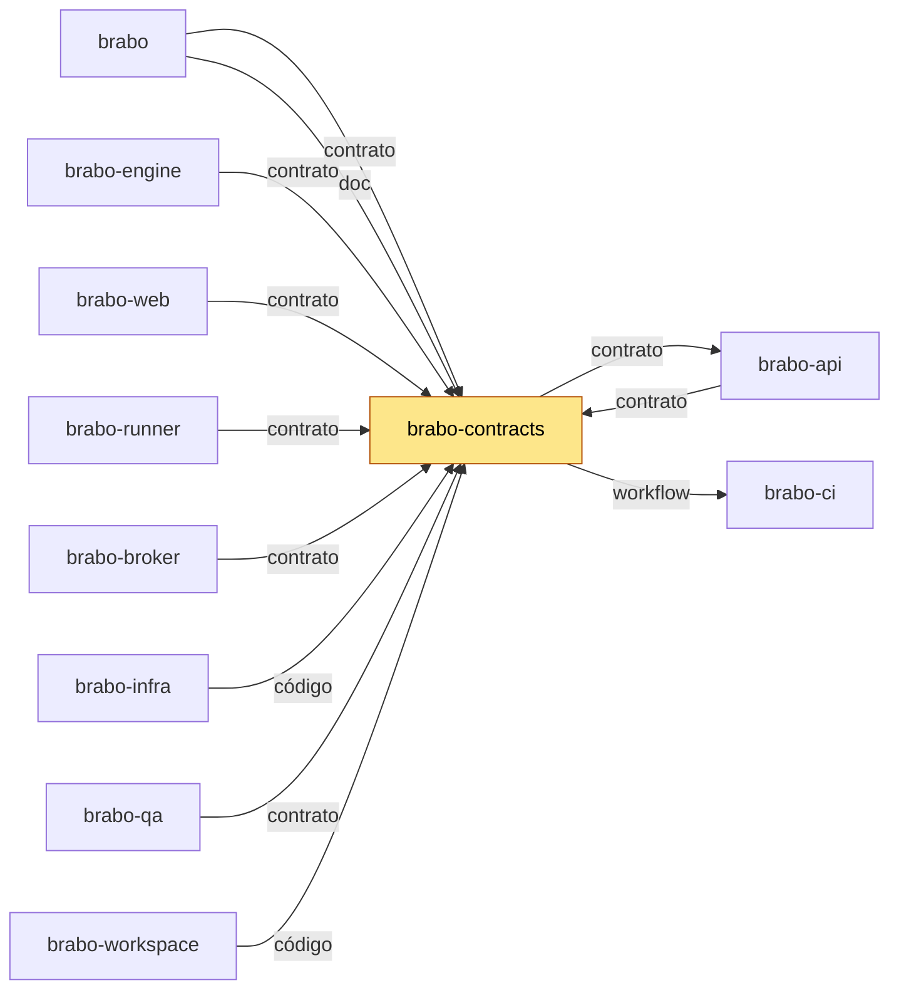

# brabo-contracts

Contratos compartilhados entre os repos do Brabo: uma cópia única de cada forma, lida por tag.

## Para que existe

Se cada repo guardasse a sua cópia dos tipos, das áreas e das operações de Docker, eles logo
divergiriam. Este repo é a cópia única: dois pacotes npm (`shared`, só tipos, e `docker-port`, a
porta de acesso ao Docker) e três arquivos de dados (`areas.json`, `fluxo.yml`, `docker-cli.json`).
Quem consome pega a versão de uma tag, nunca de uma branch.

## Onde se encaixa

O Brabo é dividido em repositórios por camada (ADR 0252). O bloco abaixo sai do `repos.yml` do brabo
e mostra de quem este repo depende e quem depende dele.

<!-- mapa:inicio -->
<!-- Gerado do repos.yml do brabo por brabo-ci:scripts/ci/mapa-dos-repos.ts. Não edite à mão. -->

**brabo-contracts** — Contratos compartilhados — os pacotes `shared` e `docker-port`, `areas.json` e `fluxo.yml`. Consumido por TAG (pacote no GitHub Packages ou arquivo baixado por raw na mesma tag); uma tag nova pede bump em api, web, runner, broker, engine, qa e infra.

| repo | propósito | como é usado | depende de | é usado por |
|---|---|---|---|---|
| brabo | Porta de entrada do produto — documentação agregada, site, instalador e release. | Quem instala usa o `install.sh` e as imagens e o binário das tags de `componentes.json`; o brabo-infra o clona nas aferições cruzadas. | brabo-api (imagem, doc), brabo-engine (imagem, doc), brabo-web (imagem, doc), brabo-broker (imagem, doc), brabo-runner (imagem, doc), brabo-infra (imagem, código, doc), brabo-contracts (contrato, doc), brabo-ci (doc, workflow), brabo-qa (doc) | brabo-ci (contrato), brabo-infra (código), brabo-workspace (código) |
| brabo-api | API do produto (NestJS, Drizzle, PostgreSQL/pgvector) — schema, RBAC, LLM, metering e gates. | Imagem publicada por tag e consumida pelo brabo e pelo brabo-infra; o brabo-web, o brabo-engine e o brabo-qa leem o código ou o `openapi.json` dele. | brabo-contracts (contrato), brabo-infra (código), brabo-qa (workflow), brabo-ci (workflow) | brabo (imagem, doc), brabo-engine (código), brabo-web (contrato), brabo-contracts (contrato), brabo-infra (código), brabo-qa (código), brabo-workspace (código) |
| brabo-engine | Engine (Elixir/OTP, Phoenix, Oban) — agentes, sessões, gates e roteamento de runners. | Imagem publicada por tag, usada pelo brabo e pelo brabo-infra. | brabo-contracts (contrato), brabo-api (código), brabo-runner (código), brabo-qa (workflow), brabo-ci (workflow) | brabo (imagem, doc), brabo-infra (código), brabo-qa (código), brabo-workspace (código) |
| brabo-web | Interface web (React 19, Vite) — telas, i18n e design system. | Imagem publicada por tag, usada pelo brabo e pelo brabo-infra. | brabo-contracts (contrato), brabo-api (contrato), brabo-qa (workflow), brabo-ci (workflow) | brabo (imagem, doc), brabo-infra (código), brabo-qa (código), brabo-workspace (código) |
| brabo-runner | CLI `brabo-runner` na máquina do usuário — PTY, container local e espelho. | Binário publicado por tag, instalado pelo brabo; o brabo-engine e o brabo-qa leem o código dele nos testes. | brabo-contracts (contrato), brabo-ci (workflow) | brabo (imagem, doc), brabo-engine (código), brabo-infra (código), brabo-qa (código), brabo-workspace (código) |
| brabo-broker | Único processo com o socket do Docker do servidor. | Imagem publicada por tag, usada pelo brabo e pelo brabo-infra. | brabo-contracts (contrato), brabo-qa (workflow), brabo-ci (workflow) | brabo (imagem, doc), brabo-infra (código), brabo-qa (código), brabo-workspace (código) |
| **brabo-contracts** | Contratos compartilhados — os pacotes `shared` e `docker-port`, `areas.json` e `fluxo.yml`. | Consumido por TAG (pacote no GitHub Packages ou arquivo baixado por raw na mesma tag); uma tag nova pede bump em api, web, runner, broker, engine, qa e infra. | brabo-api (contrato), brabo-ci (workflow) | brabo (contrato, doc), brabo-api (contrato), brabo-engine (contrato), brabo-web (contrato), brabo-runner (contrato), brabo-broker (contrato), brabo-infra (código), brabo-qa (contrato), brabo-workspace (código) |
| brabo-ci | Workflows reutilizáveis e a política de PR, escada de aprovação, promoção, tag e Dependabot. | Cada repo chama `uses: viralabs-dev/brabo-ci/...@<sha>`, fixado por SHA. | brabo-qa (contrato, workflow), brabo (contrato) | brabo (doc, workflow), brabo-api (workflow), brabo-engine (workflow), brabo-web (workflow), brabo-runner (workflow), brabo-broker (workflow), brabo-contracts (workflow), brabo-infra (workflow), brabo-qa (workflow), brabo-workspace (código, workflow) |
| brabo-infra | Composes, Dockerfiles de integração, `deploy/k8s`, scripts de dev, release e cadeia de suprimentos. | O brabo clona o brabo-infra no ref de `componentes.json` para subir a instalação; o brabo-api e o brabo-qa o clonam no CI. | brabo-api (código), brabo-engine (código), brabo-web (código), brabo-broker (código), brabo-runner (código), brabo-contracts (código), brabo (código), brabo-qa (workflow), brabo-ci (workflow) | brabo (imagem, código, doc), brabo-api (código), brabo-qa (código), brabo-workspace (código) |
| brabo-qa | E2E de navegador (Playwright), golden-sets e catálogo de funcionalidades — o portão da `main`. | O brabo-ci dispara o `e2e-pr` dele e lê o `funcionalidades.yml`; api, engine, web, broker e infra o chamam como portão. | brabo-api (código), brabo-engine (código), brabo-web (código), brabo-runner (código), brabo-broker (código), brabo-infra (código), brabo-contracts (contrato), brabo-ci (workflow) | brabo (doc), brabo-api (workflow), brabo-engine (workflow), brabo-web (workflow), brabo-broker (workflow), brabo-ci (contrato, workflow), brabo-infra (workflow), brabo-workspace (código) |
| brabo-workspace | Pasta-mãe `~/dev/brabo/` com os clones lado a lado e o `clonar-tudo.sh`. | Quem desenvolve roda `clonar-tudo.sh` uma vez; as sessões do Claude abrem nela. | brabo (código), brabo-api (código), brabo-engine (código), brabo-web (código), brabo-runner (código), brabo-broker (código), brabo-contracts (código), brabo-ci (código, workflow), brabo-infra (código), brabo-qa (código) | — |


<!-- mapa:fim -->

## Como é usado

Os pacotes são `@viralabs-dev/brabo-shared` e `@viralabs-dev/brabo-docker-port`, públicos no GitHub
Packages (ADR 0270, que revisa o item 2 da ADR 0252). Saem juntos, com a mesma versão, a da tag:
`vX.Y.Z-dev.N` (dist-tag `dev`) a cada merge na `dev` e `vX.Y.Z` (`latest`) na `main`. A publicação
é só do workflow `publish.yml`, nunca à mão.

Mesmo público, o registry do GitHub exige token para instalar. O `.npmrc` do consumidor leva só o
registry; o token fica no `~/.npmrc` (PAT classic com `read:packages`) ou, no CI, no `GITHUB_TOKEN`:

```ini
@viralabs-dev:registry=https://npm.pkg.github.com
```

O consumidor fixa a versão exata e importa pelo alias do pnpm, sem mexer nos imports. Com a versão
final `1.2.0`:

```bash
pnpm add "@brabo/shared@npm:@viralabs-dev/brabo-shared@1.2.0" "@brabo/docker-port@npm:@viralabs-dev/brabo-docker-port@1.2.0"
```

O `shared` é só tipos (o `dist/index.js` sai vazio, RN-1037). O `docker-port` é ESM compilado.
O Elixir e a web baixam `areas.json`, `fluxo.yml` e `docker-cli.json` por raw, na mesma tag.
Nunca fixe numa branch.

`packages/contracts/areas.json` é GERADO pelo `brabo-api` (`pnpm gerar:areas`, que escreve
`contracts/areas.json` lá). Quando a lista de áreas muda na api, copie o arquivo para cá e corte uma
tag nova; a web e a engine conferem a cópia delas contra a tag.

## Como desenvolver

Pré-requisitos: Node 26 e pnpm 11.3.0, as mesmas versões do CI. Rode na raiz, nesta ordem, o que o
job `pacotes` do `ci.yml` roda:

```bash
pnpm install --frozen-lockfile
pnpm -r build
pnpm typecheck
pnpm test
pnpm -r exec npm pack --dry-run
```

Cada passo sai com código 0; o último mostra o que seria publicado (só `dist`).

## O que o CI garante

| Check | Obrigatório | O que prova |
| --- | --- | --- |
| `pr-police / Política de branches` | sim (ruleset) | o nome da branch, a origem e o destino da PR seguem a política do brabo-ci. |
| `escada / Escada de aprovação` | sim (ruleset) | a PR tem as aprovações do degrau (`dev` ou `main`). |
| `pacotes` (`ci.yml`, "Typecheck e testes") | não | build, typecheck, testes e o `npm pack --dry-run` dos dois pacotes. |
| `cadeia` (`ci.yml`) | não | actionlint dos workflows e que cada `uses:` do brabo-ci está fixado por SHA de uma tag. |
| `dependencias` | não | a PR espera as PRs citadas em `Depende-de:` no corpo. |
| `readme` | não | o README segue o esqueleto de 8 seções e o bloco do mapa está em dia. |

Um `publish.yml` roda a cada tag `v*`: publica os dois pacotes no GitHub Packages. Não é check de PR.

## Documentação

- [`packages/docs/business-rules/contracts.md`](packages/docs/business-rules/contracts.md): as RNs
  dos contratos, em pt-BR. O brabo lê este arquivo ao montar o site.
- [`CHANGELOG.md`](CHANGELOG.md) (o que mudou em cada tag) e [`CLAUDE.md`](CLAUDE.md) (regras deste repo).
- Documentação central do Brabo: https://viralabs-dev.github.io/brabo/prd/.

## Como replicar no seu projeto

Do que este repo serve a outro projeto:

- **Os dois pacotes**, instalados pela tag como em [Como é usado](#como-é-usado).
- **O padrão de publicação:** `publishConfig` com o GitHub Packages e `files: ["dist"]` no
  `package.json`, e um `publish.yml` que chama o `publish-npm.yml` do brabo-ci a partir da tag.
- **Os três arquivos de dados**, baixados por raw na mesma tag.

Para o seu projeto consumir os pacotes: ponha o `@viralabs-dev:registry=https://npm.pkg.github.com`
no `.npmrc`, dê ao ambiente um token com `read:packages` e rode o `pnpm add` do exemplo, trocando a
versão pela da tag. O passo a passo de adoção da política de PR e das tags está no
[guia de adoção do brabo-ci](https://github.com/viralabs-dev/brabo-ci/blob/v1.4.0-dev.14/scripts/ci/docs/tutorials/adotar.md).

## Apoie

Se o projeto te ajuda, você pode [pagar um café no Ko-fi](https://ko-fi.com/daneiel).

## Licença

MIT. Veja o arquivo [LICENSE](LICENSE).
